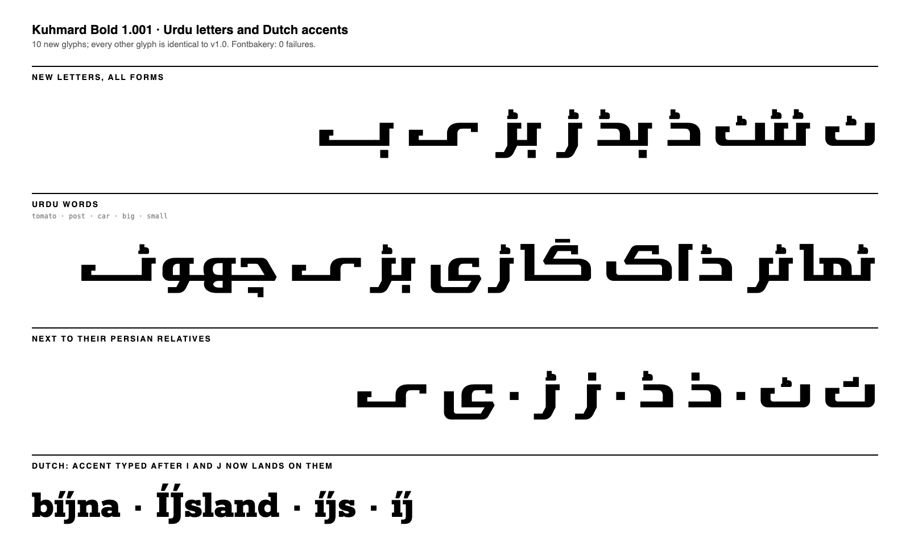

# Kuhmard · کوهمرد

**A Persian slab serif, designed to pair with Latin slab serifs like Rockwell.**
Kuhmard is the first typeface from [Azrast](https://azrast.com), a Persian type foundry.
Slab serifs are everywhere in posters, logos, menus and signs, but Persian has never had a
matching voice. Kuhmard is drawn from the right: a Persian slab with square ends and heavy
strokes, with its own Latin, so bilingual work finally looks like one design.



## About

- **Style:** one weight, Bold
- **Scripts:** Persian and Arabic (with the Urdu letters ٹ ڈ ڑ ے), Latin (Google Fonts Latin Core)
- **Letterforms:** after the lettering of the 3rd Tehran International Film Festival (1974)
- **Latin:** adapted from [Rokkitt](https://github.com/googlefonts/RokkittFont) (OFL), resized to the Persian letter height and stroke
- **Version:** 1.002

## Team

| | |
|---|---|
| Aly Taghipour | Co-founder & Technical Director |
| Ali Shir Dastina | Co-founder & Design Director |
| Fateme Cheraghi | Lead Type Designer |
| Fateme Bluekey | Type Designer |

## Build

There are two ways to build Kuhmard. Both give the same font.

### From the UFO source (Google Fonts)

`sources/Kuhmard-Bold.ufo` holds every outline, width, OpenType feature and font setting.
Build it in one command with [gftools](https://github.com/googlefonts/gftools):

```
pip install gftools
gftools builder sources/config.yaml   # writes fonts/ttf, fonts/otf and fonts/webfonts
```

### From the drawings

The UFO is made from the drawings in `sources/` with Python 3.9+:

```
pip install -r requirements.txt
brew install potrace          # or apt install potrace
cd sources
python3 build_ai.py Bold      # writes otf/, woff2/ and features/Kuhmard-Bold.fea
python3 export_ufo.py otf/Kuhmard-Bold.otf features/Kuhmard-Bold.fea Kuhmard-Bold.ufo
```

- `ai_glyphs.json`: the Persian master drawing, letter by letter
- `marks_drawn.json`: the drawn signs and marks
- `latin/latin_glyphs.json`: the Latin letters exported from Rokkitt by `latin/latin_export.py`
- `dotfix.py`, `test_collisions.py`: find crowded dots after a build and move them
- `export_ufo.py`: writes the UFO source from a build
- `compare_ufo_build.py`: checks that a font built from the UFO matches the drawing build
  (outlines, widths, character map, names, metrics, and 75,000 shaping tests with HarfBuzz)

Every change is checked with [Fontbakery](https://github.com/fonttools/fontbakery) (Google Fonts profile).

## License

Kuhmard is licensed under the [SIL Open Font License 1.1](OFL.txt). You can use it freely in
any project, personal or commercial, and share or change it under the same license.

"Rockwell" is a trademark of The Monotype Corporation. Kuhmard is not affiliated with Monotype.
